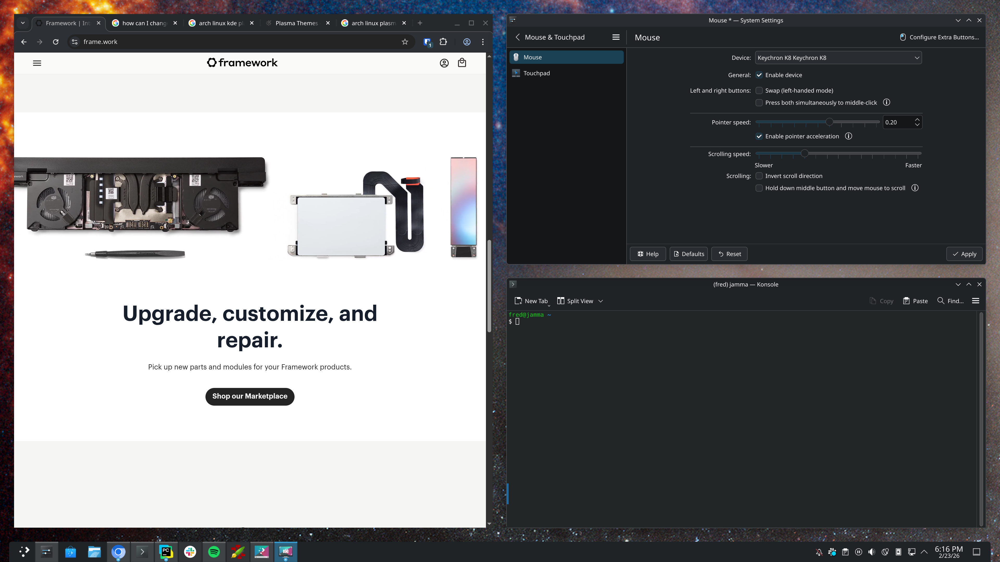
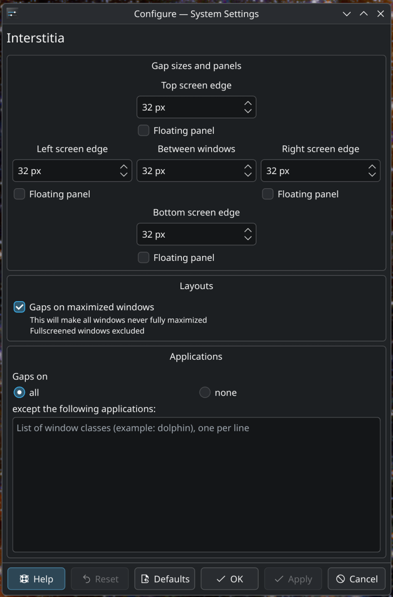

# Interstitia

Interstitia is an extension for KDE's window manager that adds space around tiled and maximized windows: between each window and the screen edges, and between windows tiled side by side.

The size of the gap and the applications to be gapped are configurable.

Interstitia works with KWin's own quick tiling (Meta+arrow keys, or dragging a window to a screen edge); it does not tile windows on its own. Floating windows keep exactly the size and position you give them, with one exception, described under *Dropping windows* below.





## This is a fork!
The original project is [here](https://github.com/nclarius/tile-gaps) and appears to be abandoned with no activity since early 2023. This version is maintained at [FredworkLemmas/interstitia](https://github.com/FredworkLemmas/interstitia).

Interstitia has been updated for Plasma 6 and is known to work in Plasma 6.5 through Plasma 6.8. It is no longer compatible with Plasma 5.

So far, in addition to addressing the api updates, I've addressed a few bugs around border consistency and drag behaviors.

I have new features planned, so stay tuned.

## Installation

### Dependencies

`kwin` on Plasma 6.

#### Arch Linux
##### packages:
- qt6-tools

##### notes:
- the install script needs `qdbus` to be in the path (for me, append `/usr/lib/qt6/bin/` to `$PATH` in `.bash_profile`)

### Installation via graphical interface

**Please make sure to select the most recent version** in the installation process.

1. Install the script via *System Settings* > *Window Management* > *KWin Scripts* > *Get New Scripts …* > search for *Interstitia* > *Install*.
2. Enable the script by activating its checkbox, and apply the settings.

### Installation via command line

```bash
git clone https://github.com/FredworkLemmas/interstitia.git
cd interstitia
./install.sh
```

### Dropping windows

When you drag a floating window and drop it, Interstitia checks whether it is close to a quick-tile spot: the left or right half, one of the four quarters, or the whole screen.

*   **Lined up with a spot:** if every edge of the window is within 24 pixels of a spot, the window is quick-tiled into it, with gaps, just as if you had pressed Meta+arrow.
*   **Against a screen edge:** if the window touches a screen edge (within 24 pixels, or past it), it is quick-tiled into whichever spot along that edge it overlaps most. Against the left edge, that is the left half or one of the left quarters.
*   **Anywhere else:** nothing changes. Interstitia never resizes a floating window, or the windows around it.

Resizing a window never snaps it.

### Cascading Windows

Interstitia can "cascade" windows that share a tile spot (a half, a quarter, the top or bottom half, or maximized), offsetting each by 32 pixels so you can see every title bar in the stack. The cascade fills the windows' actual tile, so it follows KWin's split wherever you have dragged it, and moves with it when you drag it again.

*   **Start Cascade (`Ctrl+}`):** Cascades the windows in the active window's spot. Pressing it again brings the top-left window to the front, so repeated presses walk round the whole group.
*   **Stop Cascade (`Ctrl+{`):** Puts every window in the group back on the full spot, with the active window on top.

A cascade group keeps its windows in a fixed order. The active window is always the one furthest down and to the right. Focusing another window in the group (clicking it, or Alt+Tab) rotates the group after a short pause: the windows that were below and to the right of it move round to the top-left, in order, and it takes the bottom-right place. If you press on a window's title bar and drag it, it leaves the group without moving first, and stays in front of the windows left behind.

*   **Joining:** drop a window onto a group, or move it into the group's spot with `Meta`+arrow keys. It joins at the bottom-right.
*   **Leaving:** drag a window out, move it to another spot with `Meta`+arrow keys, maximize it, or close it.

Cascade groups belong to one activity and one virtual desktop. Groups in the same spot on different activities or desktops never affect each other, and a window that is on several activities can be in a different group on each. Switching activity or desktop lays out that activity's and desktop's groups.

## Configuration

*System Settings* > *Window Management* > *KWin Scripts* > *Interstitia* > configuration button.

You may need to uncheck the checkbox for the script, apply the settings, recheck, and reapply in order for the changes to take effect.

### Screen edges

Gap sizes are counted from the area that windows maximize to, i.e. from the edge of any panel you may have on that screen edge, rather than the outer screen edge itself.

### Panels

Gaps on panels are not provided by this extension, but by the Plasma panel: Right-click on panel > *Enter Edit Mode* > *More Settings...* > *Floating Panel*.  

If you have any floating panels, specify this in the configuration so that gaps can be adjusted accordingly.

Latte dock is no longer maintained, and not officially supported by this extension.

### Sticky Window Snapping

For [Sticky Window Snapping](https://store.kde.org/p/1112552/) to work with gaps, make sure you have the threshold in the SWS configuration set to at least the largest gap size.

### Applications

To find the window class name of an application: Right-click on the titlebar of a window of the application > *More Actions* > *Configure Special Application Settings...* > the pre-filled entry in *Window class (application)* (if it consists of two words, only the second part) is the window class to put in the script configuration.


## Thanks

Thanks to Felix Jara ([@felix-clabs](https://github.com/felix-clabs)) for tests covering screens whose work area doesn't start at 0,0 ([#12](https://github.com/FredworkLemmas/interstitia/pull/12)).

## Small Print

© 2022-2023 Natalie Clarius \<natalie_clarius@yahoo.de\> [nclarius.github.io](https://nclarius.github.io)

© 2026 Fred McDavid \<fred@frameworklabs.us\> [github.com/FredworkLemmas](https://github.com/FredworkLemmas)

This work is licensed under the GNU General Public License v3.0.  
This program comes with absolutely no warranty.  
This is free software, and you are welcome to redistribute and/or modify it under certain conditions.

If you like this project, you can star the [github repo](https://github.com/FredworkLemmas/interstitia) and review the script in the [kde store](https://www.pling.com/p/2349376/).
